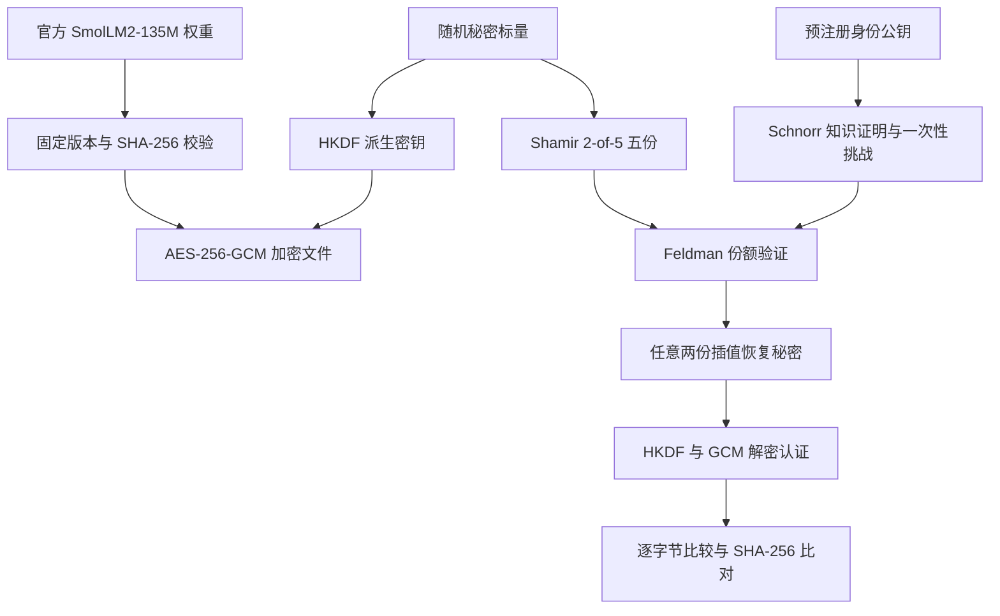

# SmolLM2-135M 基座权重：加密、秘密共享、份额验证与身份知识证明

## 1. 本次实现的目标

使用官方 **`HuggingFaceTB/SmolLM2-135M` 基座版**的 `model.safetensors` 作为被保护文件。不是 Instruct 版，不训练或运行语言模型，也不让模型生成密钥。只需 CPU 与 Python 3.12，无需 PyTorch、Transformers 或 GPU。

秘密共享的对象是派生文件加密密钥的随机秘密标量。恢复该标量后，用相同 HKDF 派生出同一 AES 密钥。五方中任意两方可以恢复；一方不能通过恢复接口。模型权重不被切割为五个明文片段。



## 2. 代码改动

| 文件 | 工作内容 |
| --- | --- |
| `smollm2.py` | 新增 `download` 与 `run` 命令；固定官方模型身份，校验下载，执行权重文件实验并保存恢复文件 |
| `demo.py` | 复用全部 10 个组合的实验流程；新增输入/恢复 SHA-256、恢复回调、真正的密文本体篡改检查；汇总失败显式报错 |
| `protocol.py` | 分段更新文件上下文哈希，减少大字节串拼接；一次认证恢复只计算一次文件上下文 |
| `tests/test_smollm2.py` | 新增离线文件流程、模型清单校验、下载校验、损坏下载清理与输出保护测试 |
| `.gitignore` | 忽略下载权重目录 `models/`，避免把模型上传 GitHub |
| `README.md`、本说明和本地操作说明 | 新增模型实验入口，明确实际验证范围与输出解释 |

模型、密文、恢复权重均不提交 Git。现有 CI 运行所有离线测试及小样本演示，不在 CI 下载模型。

## 3. 四个技术点如何实现

### 加密：AES-256-GCM

使用随机秘密 `s`，经 HKDF-SHA256 派生 32 字节密钥。每次加密生成随机 12 字节 nonce，使用 16 字节认证标签。协议版本、门限、参与方数量和 Feldman 承诺作为附加认证数据。修改密文、nonce、标签或相关元数据，会导致校验或认证失败。

### 秘密共享：Shamir 2-of-5

在 P-256 群阶 `q` 上构造 `f(x) = s + a*x mod q`，为五方分配 `(i, f(i))`，其中 `i=1..5`。两方 `i,j` 使用：

```text
s = (y_i*j - y_j*i) * (j-i)^(-1) mod q
```

从而恢复同一秘密并派生同一加密密钥。接口拒绝少于两份、重复编号和非法份额；提交超过两份时先验证全部份额，再选择前两份插值。

### 份额验证：Feldman 承诺

公布 `C0=sG`、`C1=aG`。每份必须满足 `y_i*G == C0+i*C1`，否则拒绝。承诺必须来自可信分发者，真实部署还要保证承诺分发的真实性。公开承诺依赖椭圆曲线离散对数困难性，不应把包含承诺的整体系统描述为信息论隐藏。

### 身份知识证明：Schnorr

每方拥有独立于份额的身份私钥 `x`，公钥 `Y=xG` 预先注册。证明生成随机 `r`、`R=rG`，计算绑定身份编号、公钥、`R`、文件上下文摘要和验证者 nonce 的挑战 `c`，输出 `z=r+c*x mod q`。验证 `zG == R+cY`。

验证者发放 32 字节随机 nonce，并在验证尝试时消费它；同一证明和挑战再次提交会被拒绝。文件上下文包含协议元数据、加密 nonce、密文和标签，因此证明不能直接用于另一文件。证明说明持有注册私钥，不证明现实中的实名身份。

`Verifier.authenticate_and_recover` 集成身份认证与恢复；`recover` 是用于密码学测试的底层函数，本身不检查身份。此区别对真实访问控制很重要。

## 4. 本地安装

安装 Git 和 Python 3.12，打开终端：

```bash
git clone https://github.com/ZhouJay798/TVMC_test.git
cd TVMC_test
git switch main
```

已有仓库时使用 `git pull --ff-only` 更新，先保存自己的修改。

Windows PowerShell：

```powershell
py -3.12 -m venv .venv
.\.venv\Scripts\python.exe -m pip install -r requirements.txt
.\.venv\Scripts\python.exe -m unittest discover -s tests -v
```

macOS / Linux：

```bash
python3.12 -m venv .venv
.venv/bin/python -m pip install -r requirements.txt
.venv/bin/python -m unittest discover -s tests -v
```

预期 `Ran 20 tests ... OK`（原有 15 项加新增 5 项 Tardos 编码与指标测试）。其中模型工作流测试使用明确标注的合成字节和模拟下载响应，不代表已经下载或验证真实模型。

建议预留至少 4 GB 可用内存和 2 GB 磁盘空间。实际需求随官方权重大小而定：磁盘需容纳原权重、等长密文、恢复权重；当前仍整文件读入内存，测试期间会临时保留若干份文件大小的字节串。报告体积很小，不保存十份恢复文件。

## 5. 下载官方权重

Windows：

```powershell
.\.venv\Scripts\python.exe smollm2.py download
```

macOS / Linux：

```bash
.venv/bin/python smollm2.py download
```

成功后生成：

```text
models/SmolLM2-135M/model.safetensors
models/SmolLM2-135M/manifest.json
```

下载器先经 HTTPS 查询官方模型 API，把 `main` 解析为具体 40 位提交 SHA，再按该 SHA 下载。临时文件通过官方 LFS 元数据给出的 SHA-256 和大小校验后才改名为正式权重；校验失败清理临时文件，不继续实验。TLS 校验始终开启。

`manifest.json` 保存模型 ID、固定 revision、文件名、大小、SHA-256 和来源。首次下载默认解析当时的 `main`；跨机器复现实验时，使用该清单记录的版本：

```bash
.venv/bin/python smollm2.py download --revision <manifest中的40位revision> --cache-dir models/reproduction
```

PowerShell 将 Python 路径改为 `.\.venv\Scripts\python.exe`。重复下载会重新校验现有权重；如果已有文件与所选版本不符，命令报错，使用新的 `--cache-dir` 保存另一个版本。

离线运行依赖你保留的清单；不要从不可信来源同时获取权重与清单。SHA-256 比对只能确认文件符合给定清单，不能让攻击者自制的清单变可信。

下载所需域名包括 `huggingface.co`，以及其重定向使用的 `cas-bridge.xethub.hf.co`、`cdn-lfs.huggingface.co`、`cdn-lfs-us-1.hf.co`。若环境网络规则阻断，先放行实际需要的域名。此公开模型默认无需令牌；不要通过关闭 TLS 或改用来源不明的镜像绕过错误。模型的使用与分发遵循官方模型卡和许可证。

## 6. 执行真实模型实验

Windows：

```powershell
.\.venv\Scripts\python.exe smollm2.py run --output artifacts/smollm2-run-1
```

macOS / Linux：

```bash
.venv/bin/python smollm2.py run --output artifacts/smollm2-run-1
```

`run` 不访问网络，先检查本地清单与文件，再执行完整流程。若在其他机器完成官方校验下载，可将权重与清单一同复制过来，通过 `--model-file` 和 `--manifest` 指定路径。

每次选择新的输出目录；非空目录会被拒绝，避免覆盖已有证据。加密文件与恢复文件不要上传仓库。

| 输出 | 内容 |
| --- | --- |
| `encrypted.bin` | 与原权重等长的二进制 GCM 密文 |
| `envelope.json` | 协议元数据、公开承诺、加密 nonce、标签及密文文件名 |
| `recovered.safetensors` | `(1,2)` 组合认证恢复后保存的权重；其他九对在内存中逐字节验证 |
| `report.json` | 模型来源、固定版本、SHA-256、十对结果、拒绝结果、耗时和证据大小 |

这里的 `recovered.safetensors` 是明文模型权重。五方份额、身份私钥与派生密钥仅在本次进程内存在，不写入报告；因此本工具没有跨进程“导入两份再解密”的持久化保管功能。

## 7. 手动观察结果

用编辑器打开 `report.json`，检查：

1. `model.model_id` 是 `HuggingFaceTB/SmolLM2-135M`，`model.revision` 为具体提交，`input_bytes` 与清单文件大小一致。
2. `pairs` 恰好 10 项，覆盖五方任意两方，每项 `correct=true`，`recovered_sha256` 等于 `input_sha256`。
3. `input_sha256`、`model.sha256`、`recovered_file_sha256` 相同。
4. `attacks_rejected` 六项全部为 `true`：`single_share`、`tampered_share`、`duplicate_share`、`tampered_tag`、`proof_replay`、`tampered_ciphertext`。`true` 表示成功拒绝，不是攻击成功。

Windows 可独立检查落盘权重：

```powershell
Get-FileHash models/SmolLM2-135M/model.safetensors -Algorithm SHA256
Get-FileHash artifacts/smollm2-run-1/recovered.safetensors -Algorithm SHA256
```

Linux：

```bash
sha256sum models/SmolLM2-135M/model.safetensors artifacts/smollm2-run-1/recovered.safetensors
```

macOS 用 `shasum -a 256` 代替 `sha256sum`。两行哈希必须相同。

## 8. 耗时与证据大小解读

| 指标 | 含义 |
| --- | --- |
| `encryption_ms` | 秘密生成、承诺、加密和五份生成；不含下载与磁盘读入 |
| `pairs[].proof_generation_ms` | 两方证明生成之和；使用预先计算的文件上下文 |
| `pairs[].verified_recovery_ms` | 上下文计算、两方身份验证、份额验证、秘密恢复和解密；不含随后比较、SHA-256 与保存明文 |
| `attack_check_ms` | 各失败检查的耗时；篡改输入构造不都在计时范围内，不应当作纯算法基准 |
| `experiment_seconds` | 已读入验证后的数据开始实验，至输出密文、恢复文件、封装及恢复文件哈希检查完成；不含下载、前置校验和最终报告写入 |

每次使用新输出目录重复实验，可汇总中位数和范围。模型权重越大，上下文哈希与 AES 文件处理占比越高。报告不包含模型推理耗时，`model_inference_performed=false`。

证据使用未压缩 P-256 点与固定宽度标量计数：单份 `33` 字节，文件级两个承诺 `130` 字节，单方身份公钥 `65` 字节，单方 Schnorr 证明 `97` 字节，挑战 `32` 字节，文件摘要 `32` 字节。两份证明为 `194` 字节，另计公钥、挑战、上下文和其他通信包装。这些不是 JSON 文件大小，也不是含模型密文的总传输量。

## 9. 本次验证记录与限制

- 原有 8 项密码学测试通过。
- 新增 7 项离线测试通过；总计 15 项。合成文件测试覆盖十对恢复、六项拒绝、明文落盘一致性、输入校验、下载损坏拒绝和旧输出保护。
- 小样本演示成功，真正的密文本体篡改与 GCM 标签篡改分别报告。
- 当前新增的 `fingerprint.py prepare` 可使用官方 Hub 下载器取得并校验相同真实权重。本文的离线加密测试不等同于真实权重的十对实测；请以本地 `smollm2.py run` 生成的报告为准。模型指纹训练的实测结果单独记录于 [Tardos 实测记录](TARDOS_RESULTS.md)。

项目是研究原型，单进程模拟分发者与五方。没有真实身份注册服务、分布式挑战状态、份额网络分发或常数时间 Python 标量实现，也未进行安全审计。成功的单份拒绝测试不等同于密码学安全证明。无须启动服务；后续任务应使用现有仓库和虚拟环境。
