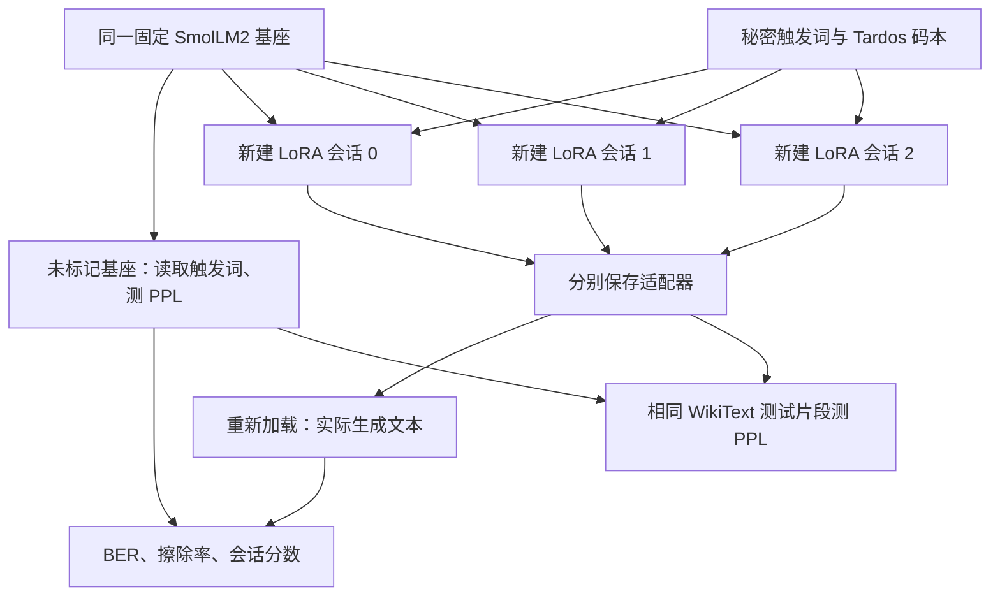

# SmolLM2 的 Tardos 指纹：独立 LoRA 会话、文本读取与 CPU 实验

## 1. 这次改了什么

在原 `TVMC_test` 仓库新增模型指纹实验。原有文件加密、秘密共享、Feldman 验证和 Schnorr 身份证明仍可独立运行。

本实验将同一个 `HuggingFaceTB/SmolLM2-135M` 基座分别复制为多个逻辑会话，每个会话只训练自己的 LoRA，写入不同的 Tardos 码字。这里“会话”表示**独立适配器实例**，不是聊天窗口的多轮对话。

| 文件 | 用途 |
| --- | --- |
| `tardos_code.py` | 截断反正弦概率、二进制码字、文本解码、BER/擦除率及 Tardos 分数 |
| `fingerprint.py` | 下载训练资源、独立训练 LoRA、读取保存后的适配器、测量困惑度和资源 |
| `requirements-fingerprint.txt` | 独立的模型训练依赖；不强制原密码学实验安装 PyTorch |
| `tests/test_tardos.py` | 编码、评分公式、擦除和严格文本判定测试 |
| `tests_fingerprint/test_training.py` | 使用小型随机 Llama 验证真实 LoRA 训练、保存重载、三会话隔离与独立读取 |

固定基座版本：`93efa2f097d58c2a74874c7e644dbc9b0cee75a2`。复用此前下载的 `models/SmolLM2-135M/model.safetensors`；还需要模型配置、分词器和 WikiText-2 数据。不会在秘密共享代码中加入语言模型依赖，也不会将训练产物提交 Git。

## 2. 实验流程



每个会话加载全新基座，创建 `q_proj`、`v_proj` 上的 LoRA；没有从前一个会话继续训练。程序核对各会话初始冻结参数哈希一致，训练前后冻结参数哈希一致、LoRA 参数哈希发生变化。保存后重新加载适配器再读取，验证实际落盘的 LoRA 写入。

## 3. Tardos 编码与评分

默认 3 个会话、32 个码位、截断参数 `δ=0.1`。每个位置先生成共享偏置：

```text
θ_i ~ Uniform(asin(sqrt(δ)), π/2 - asin(sqrt(δ)))
p_i = sin²(θ_i)
x_(u,i) ~ Bernoulli(p_i)
```

`x_(u,i)` 是会话 u 的第 i 位。多个会话共享 `p_i` 和触发词，但拥有各自的码字。若码字完全重复，程序报错，需换码本或增加码长。

每个触发词包含随机 96 位标识。模型被训练为在触发后生成以下之一：

```text
bit 0 → amber.
bit 1 → cobalt.
```

读取时用贪心生成，最多生成 8 个新 token。只检查**生成的新文本**，去除首尾空白后必须恰好为 `amber.` 或 `cobalt.`；其他回答一律记作擦除 `null`。不会通过候选答案概率强行选出某一位，也不会在回答里搜索某个单词便算成功。

对读取结果 `y_i`，会话 u 的对称 Tardos 分数为：

```text
S_u = Σ (2*y_i - 1) * (x_(u,i) - p_i) / sqrt(p_i*(1-p_i))
```

仅对未擦除位置求和。另报 `S_u / sqrt(可读位数)`。全部擦除时原始分数为 0、归属为 null，不会强行判给第一个会话。分数并列也不做唯一归属。

**这是短码的实验性 Tardos 指纹实现，不提供经过校准的定罪阈值或抗合谋保证。** 32 位码和 3 个独立会话不能替代长码、多随机种子、独立阴性模型与合谋攻击实验。`top_session` 只表示最高分候选，不能直接当成具有确定误报率的归属结论。

## 4. 写入损失与正常能力评估

写入损失只监督触发后的答案和结束符，触发文本的标签置为 `-100`。每一步同时取 WikiText-2 **train** 中的一段，优化：

```text
loss = fingerprint_response_loss + 0.5 * natural_text_loss
```

默认 LoRA rank=8、alpha=16、学习率 0.001，每会话 200 步、指纹 batch=4、自然文本 batch=1，CPU 使用 float32 和 4 个线程。

正常能力使用 WikiText-2 **test** 的前 4096 token，与基座使用完全相同的数据、分块和计数规则计算：

```text
PPL = exp(所有被预测 token 的总负对数似然 / 被预测 token 数)
相对变化 = 会话 PPL / 基座 PPL - 1
```

使用最长 128 token 的不重叠块，每块首 token 不计入预测数；报告实际 `predicted_tokens`。保留训练数据默认为 train 前 16384 token。数据集固定提交 `b08601e04326c79dfdd32d625aee71d232d685c3`，保存 train/test 文件哈希；测试文本不加入训练损失。

PPL 只衡量这一英语语言建模样本上的能力变化，不能证明聊天、数学、中文或其他下游能力全部保持。若需要较正式的保持结论，应扩大评估集，增加任务基准，并避免根据测试集反复选超参数。

## 5. Windows 10 + PyCharm + 仅 CPU：安装

在 PyCharm 底部 Terminal 打开 **PowerShell**，当前目录应为包含 `fingerprint.py` 的 `TVMC_test`：

```powershell
git pull --ff-only
.\.venv\Scripts\python.exe --version
```

沿用原来的 Python 3.12 虚拟环境即可。如果尚未建立：

```powershell
py -3.12 -m venv .venv
```

先装 CPU 版 PyTorch，再装项目训练依赖：

```powershell
.\.venv\Scripts\python.exe -m pip install torch==2.6.0 --index-url https://download.pytorch.org/whl/cpu
.\.venv\Scripts\python.exe -m pip install -r requirements-fingerprint.txt
.\.venv\Scripts\python.exe -m pip check
.\.venv\Scripts\python.exe fingerprint.py hardware
```

`torch` 应显示 `2.6.0+cpu`；`cuda_available: false` 在仅 CPU 机器上是正常结果。无需安装 CUDA。若 PyCharm 标红库导入，确认项目解释器指向 `.venv\Scripts\python.exe`。

训练比此前的文件加密更耗时。可先预留数 GB 内存（建议至少 8 GB 可用）和数 GB 磁盘，实际峰值由报告记录；本次云端 CPU 测量见 [实测记录](TARDOS_RESULTS.md)；你的电脑耗时会随 CPU、线程数和负载变化。

## 6. 准备资源

```powershell
.\.venv\Scripts\python.exe fingerprint.py prepare
```

它会校验并复用已有固定版本权重，补齐分词器与配置，并下载 `Salesforce/wikitext` 的 WikiText-2 raw train/test Parquet。准备成功后有：

```text
models/SmolLM2-135M/    # 权重、manifest、config、tokenizer 等
data/wikitext2/        # train.txt、test.txt、manifest.json、原始 parquet
```

`prepare` 需要联网，之后 `run` 和 `read` 使用本地资源。网络需访问 Hugging Face 及实际下载重定向域名，当前观察到 `us.aws.cdn.hf.co`。不要关闭 TLS 验证；若下载失败，保留错误信息排查。

## 7. 先测试，再训练

执行两个测试集：

```powershell
.\.venv\Scripts\python.exe -m unittest discover -s tests -v
.\.venv\Scripts\python.exe -m unittest discover -s tests_fingerprint -v
```

预期分别为 20 项、3 项测试通过。其中训练测试使用小型随机模型，验证代码和参数更新，不代表 SmolLM2 指纹已训练成功。

先用少步数验证电脑能跑完整流程：

```powershell
.\.venv\Scripts\python.exe fingerprint.py run --device cpu --sessions 3 --bits 16 --steps 5 --eval-tokens 512 --output artifacts/tardos-smoke
```

试运行只检查流程，5 步不足以保证写入成功；BER/擦除率高、质量门限未通过都应如实保留。每个输出目录必须是新的或空的。

正式小规模实验：

```powershell
.\.venv\Scripts\python.exe fingerprint.py run --device cpu --threads 4 --sessions 3 --bits 32 --steps 200 --output artifacts/tardos-run-1
```

终端每 25 步输出一次损失，基座评估、会话切换和读取阶段也需要时间。若内存不足，可先改为 `--batch-size 1 --seq-len 64`，这也改变训练与评估条件，比较时必须保持配置一致。

训练结果不会保证满足所有指标；程序会保存实际结果和通过/不通过状态。不要把正常退出当成“指纹写入成功”。

## 8. 训练后输出与独立文本读取

```text
artifacts/tardos-run-1/
├── report.json
├── secret_codebook.json
├── secret_baseline_readout.json
├── session-0/
│   ├── adapter_config.json
│   ├── adapter_model.safetensors
│   └── secret_readout.json
├── session-1/ ...
└── session-2/ ...
```

`secret_codebook.json` 含码本种子、偏置、码字和触发文本，需私下保留；`secret_readout.json` 含实际生成文本和解码结果。不要上传码本、读取原文或适配器作为公开测试日志。它们在被 Git 忽略的 `artifacts/` 下。

`run` 已经读取了保存后重新加载的适配器。另开一次进程重新读取、不进行任何训练：

```powershell
.\.venv\Scripts\python.exe fingerprint.py read --run-dir artifacts/tardos-run-1 --output artifacts/tardos-readback-1.json
```

查看 `readings`：第一项 `session: null` 是未标记基座，后面是各会话。每项记录生成文本、读取位和各会话分数。此命令固定使用 CPU，输出文件需尚不存在。

## 9. 如何解读 report.json

会话编号从 **0** 开始。

| 指标 | 含义 |
| --- | --- |
| `baseline.perplexity` | 未标记基座的语言建模困惑度及实际 token 数 |
| `baseline.per_session` | 同一份基座文本读取结果，相对于每个会话码字计算的 BER 和分数 |
| `sessions[].ber_on_readable` | 错误位 / 成功读出的位；全擦除时为 null，绝不是 BER=0 |
| `erasure_rate` | 未输出合法响应的位 / 总码长 |
| `error_or_erasure_rate` | (错误位 + 擦除位) / 总码长，避免只报可读位 BER 掩盖高擦除 |
| `session_scores` | 当前模型读取结果对所有候选会话的原始和归一化 Tardos 分数 |
| `top_session`、`top_score_margin` | 最高分会话与最高/次高原始分数差；无足够信息则归属 null |
| `score_gain_over_base` | 对本会话的原始分数减去未标记基座对应分数 |
| `ppl_relative_change` | 相对基座 PPL 变化，如 0.05 表示增加 5% |
| `ppl_absolute_change` | 会话 PPL 减基座 PPL |
| `training_seconds` | 该会话训练循环耗时，包含监控和损失输出；不含下载、模型加载、哈希、保存与评估 |
| `rss_initial_bytes` | 训练循环开始时进程 RSS，包括已加载模型等 |
| `rss_peak_sampled_bytes` | 每 20ms 采样的整个进程 RSS 峰值，非严格峰值、非增量内存 |
| `cuda_peak_allocated_bytes` / `cuda_peak_reserved_bytes` | GPU 分配器峰值；CPU 模式为 null |
| `initial_frozen_base_sha256` | 各会话开始时冻结参数的哈希；三者必须相同 |
| `frozen_base_unchanged` | 本会话训练前后冻结参数不变 |
| `adapter_parameters_changed` | LoRA 参数确实被更新 |
| `read_from_reloaded_adapter` | 从保存后重新加载的适配器读取 |

字节数除以 `1024³` 可以换算为 GiB。进程分配器可能保留前一个会话的内存，因此不要将后续会话 RSS 差异简单解释成 LoRA 大小差异。

默认实验门限：`fingerprint_gate_pass` 要求错误或擦除比例 ≤10% 且最高分会话正确；`ppl_gate_pass` 要求 PPL 增幅 ≤10%。两个 10% 都是可配置的实验判据，不是统计显著性或安全保证。`all_quality_gates_pass` 汇总它们；未通过表示实验测到效果不足，不应隐藏或改写成成功。

## 10. 复现与验证范围

默认每次创建新的秘密码本；`--seed` 仅控制训练随机性。要复用同一码本以对比训练配置：

```powershell
.\.venv\Scripts\python.exe fingerprint.py run --device cpu --sessions 3 --bits 32 --steps 200 --codebook artifacts/tardos-run-1/secret_codebook.json --output artifacts/tardos-run-2
```

报告记录基座 SHA、权重摘要、数据版本和摘要、配置、软件版本和码本摘要。固定环境和随机种子可改善复现，但不同硬件与库版本仍可能产生数值差异。

本次云端已执行 20 项基础/指标测试和 3 项小模型训练测试，并使用真实 SmolLM2 权重执行 CPU 三会话实验。配置、实际数值与通过/未通过结果见 [实测记录](TARDOS_RESULTS.md)。下载过程使用官方 Hub 下载器，再独立核对官方 LFS SHA-256；没有关闭 TLS 校验。

本实现验证 LoRA 写入、保存重载与文本读取的机制，并提供未标记基座对照。它尚未验证多模型合谋、去指纹微调、量化、剪枝或迁移后的鲁棒性；文本指纹也不等价于原项目的密码学身份证明。

## 11. 常见问题

- `No module named torch/peft`：使用项目 `.venv` 的 Python 安装 `requirements-fingerprint.txt`，不要把系统解释器和项目解释器混用。
- PyTorch 报 `DLL load failed`：确认是 Windows 64 位 Python 3.12；根据 PyTorch 错误提示检查 Microsoft Visual C++ x64 运行库。
- 提示缺少 `config.json` 或 tokenizer：此前加密实验只下载了权重，必须先运行新的 `fingerprint.py prepare` 补齐训练资源。
- 输出目录非空：换一个 `--output` 路径，保留前一次结果用于比较。
- 偶发提示 `duplicate codewords`：短码可能碰巧重复；重新运行生成新码本，或增加 `--bits`，不应把重复码当成不同会话。
- BER 为 null：没有任何响应被成功解码，应结合擦除率查看，不能解释为无错误。
- 指纹分数最高但 `ppl_gate_pass=false`：写入可能有效，但语言建模能力退化超过当前实验阈值，不能宣称正常能力保持。
- `CUDA unavailable`：仅 CPU 电脑请使用 `--device cpu`，无需安装 GPU 运行时。
